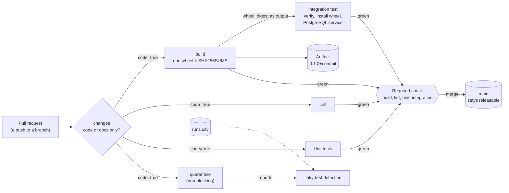

# Architecture: the CI pipeline that keeps `main` green

This document describes what the code and the workflow in this repository do and why they are shaped this way. Component names match the diagram in the lesson ("The CI pipeline you build"): **Pull request**, **Lint**, **Unit tests**, **Integration test**, **Required check**, **main** and **Artifact**.

## Components and what each owns

| Component | Where it lives | What it owns |
| --- | --- | --- |
| **Pull request** (a push to a branch) | `on: push, pull_request, merge_group` in [`ci.yml`](.github/workflows/ci.yml) | The trigger. The workflow always starts; it never filters by path. |
| **changes** | job `changes`, script [`pipeline/changes.sh`](pipeline/changes.sh) | Decides `code=true` or `code=false`: false only when every changed file is documentation. Every later job is skipped with `if:` when it is false. |
| **Lint** | job `lint`, `make lint` | Format check, ruff, mypy (strict), the import-linter contracts, the workflow lint and the README contract check. Fast, and the first thing that tells a pull request it is wrong. |
| **Unit tests** | job `unit`, `make test` | Unit tests of the service and of the pipeline's own logic, with coverage floors (95% on the domain, the application layer and the pipeline's pure core). Excludes the quarantined test. |
| **Integration test** | job `integration`, `make test-artifact` | Verifies the wheel's SHA-256, installs the wheel (not the sources) into a clean environment and runs the PostgreSQL tests against a service container. |
| **Artifact** | job `build`, [`pipeline/adapters/builder.py`](pipeline/adapters/builder.py) | One wheel, versioned `0.1.0+<commit>`, and `dist/SHA256SUMS`. Built once; every job that uses it checks the digest. |
| **quarantine** | job `quarantine`, `make quarantine` | The quarantined flaky test. `continue-on-error: true` on this job only: it runs and reports on every push and never blocks. |
| **audit** | job `audit` and weekly [`audit.yml`](.github/workflows/audit.yml) | Known-vulnerability check of the locked dependencies. Not required, so a new advisory does not block unrelated work. |
| **Required check** | branch protection on `main`, JSON from [`pipeline/core/protection.py`](pipeline/core/protection.py) | `build`, `lint`, `unit` and `integration` must be green, the branch must be up to date, direct pushes are refused, administrators included. |
| **main** | the branch | Stays releasable: the only way in is through the required check. |
| **Run log** | `runs.csv`, [`pipeline/core/runlog.py`](pipeline/core/runlog.py) | One row per pipeline run (`run,commit,seconds,result`, plus the variant, the failed tests and the first failure message). The numbers the lesson is about, and the input of flaky-test detection. |
| **Local runner** | [`pipeline/adapters/local_runner.py`](pipeline/adapters/local_runner.py), `make run` | The same jobs as the workflow, run as processes on a laptop, in parallel, with the same make targets. |
| **Protected remote (demo)** | [`pipeline/hooks/pre-receive`](pipeline/hooks/pre-receive), `make gate-demo` | A local stand-in for branch protection: a bare repository that refuses `main` without a green status. |

The service the pipeline builds is small on purpose (a time-limited cache and a background job whose runs are recorded in PostgreSQL) and layered like any production service: `domain`, `application`, `infrastructure`, `interfaces`. The pipeline tooling is a second package, `pipeline`, with its own layers (`core`, `adapters`, `cli`), and it never imports the service.

## Pattern: one definition per job, pure core, adapters at the edge

Two patterns carry the design.

**Jobs are make targets.** The workflow says where and when a job runs and what passes between jobs; `make` says what it does. The laptop runner calls the same targets, so a job that passes locally and fails in CI points at the environment, not at different commands ([ADR 0001](docs/adr/0001-one-make-target-per-job.md)).

**Pure core, adapters at the edge.** Everything with a rule in it (versions from commits, checksums, the run-log statistics, flaky-test detection, the workflow rules, the README contract) is in `pipeline/core`, takes values and returns values, and is tested without a subprocess. Git, processes, files and GitHub are in `pipeline/adapters`. import-linter enforces both directions: `core` may not import `subprocess`, sockets or HTTP, and `pipeline` may not import `small_service`.

## Data flow

### One pull request, step by step

1. A push (or a pull request, or a merge-queue entry) starts `ci.yml`. The workflow itself always starts.
2. Job `changes` checks out with full history and runs `pipeline/changes.sh BASE HEAD`. A new branch, a missing base commit or any code file gives `code=true`. Only a change made entirely of `docs/` and `*.md` gives `code=false`.
3. With `code=true`, `build`, `lint`, `unit` and `quarantine` start at the same moment: they share no `needs` between them. `integration` waits for `build`.
4. `build` runs `make build`: it stamps `0.1.0+<7 characters of the commit>` into a copy of `pyproject.toml`, builds the wheel with `SOURCE_DATE_EPOCH` set to the commit time, writes `dist/SHA256SUMS` and uploads `dist/`. Its job output is the digest.
5. `integration` downloads the wheel and runs `make test-artifact`: `pipeline verify` compares the file's SHA-256 with the output of `build` and exits 1 on a mismatch; then the wheel is installed into a clean environment and `tests/integration` runs against a PostgreSQL 16 service container. A test fails if the package under test is not in `site-packages`.
6. `lint` and `unit` also finish; `quarantine` reports its result whatever it is.
7. The required check: all four required jobs must be green (a job skipped by `changes` counts as passed) and the branch must be up to date with `main`. Then the merge is allowed and `main` moves to a commit that has passed everything.
8. The local equivalent writes one row to `runs.csv` per run: duration, result, commit, and for a failure the failed test ids and the first message line.

## Decisions and trade-offs

**Required checks are job names, not the workflow name.** GitHub waits for a check by name. A required name that no job reports blocks every merge for ever. `pipeline lint-workflows` and a unit test compare the required list (`pipeline/core/protection.py`) with the job names in `ci.yml`.

**Skipped by `if:`, not by `paths-ignore`** ([ADR 0003](docs/adr/0003-skip-with-if-never-with-paths-filters.md)). A documentation-only change should not cost five minutes, but a workflow that never starts leaves its required checks pending. A job skipped by `if:` reports as skipped, which counts as passing.

**Build once, test the artifact** ([ADR 0002](docs/adr/0002-build-once-and-test-the-artifact.md)). The version comes from the commit, so one commit gives one version, and a fixed clock makes the bytes reproducible; a digest mismatch is then always a real difference. The cost is one more job in the dependency chain; the gain is that the thing that ships is the thing that was tested.

**Three parallel jobs, not one job with parallel pytest.** Separate jobs give separate required check names, separate logs and a pull request page that says which of the three is red. They cost three runner startups (about 20 to 30 seconds each on GitHub-hosted runners) and one dependency install each; the pip cache, keyed by the hash of `requirements-dev.lock`, pays most of that back. The total time is the slowest job, not the sum.

**Cache keyed by the lock file.** `actions/setup-python` with `cache: pip` and `cache-dependency-path: requirements-dev.lock` changes the key only when a dependency changes. A key by branch name goes stale or never hits.

**Quarantine with a marker and one non-blocking job** ([ADR 0004](docs/adr/0004-quarantine-with-a-marker-and-a-non-blocking-job.md)). `continue-on-error` belongs to one job; on the whole workflow it would let real failures through, and the lint rule WF004 fails the build if it appears anywhere else.

**Actions pinned to full commit SHAs, read-only permissions, `concurrency` that cancels superseded runs on branches but never on `main`.** Pinning is enforced by rule WF005, permissions by WF007. The cost is manual updates; Dependabot (`.github/dependabot.yml`) opens them weekly.

**The local gate is a git hook** ([ADR 0005](docs/adr/0005-a-git-hook-stands-in-for-branch-protection.md)). It lets a reader watch "a failing change cannot merge, a direct push is refused" without a GitHub repository, and the same required list produces the real GitHub settings JSON.

**Structured output.** The pipeline's own commands print one line per fact (`build: sha256 ...`, `integration: sha256 ... verified`, one row per run in `runs.csv`); the service logs logfmt on standard error with levels and no secrets (the connection string, which holds the password, is never logged). Configuration is read from the environment and validated at startup; a missing password exits with code 2 and names the variable.

## Failure modes the lesson teaches, and how the code shows them

| Failure | What you see | How to reproduce or where it is prevented |
| --- | --- | --- |
| **Required check is the workflow name** | Every pull request waits for a check that never reports. | `pipeline lint-workflows` (WF001) and `tests/pipeline/test_workflow_protection_contract.py` fail when a required name is not a job name. |
| **Cache keyed by branch** | No speed-up, or stale dependencies. | The cache key is the lock file's hash (`.github/actions/setup/action.yml`); `make bench` shows the cold and the warm environment in numbers. |
| **Rebuilding in each job** | Different checksums; the check fails or never runs. | `make test-artifact` with a wheel that is not the one built exits 1 with `sha256 MISMATCH`; `tests/pipeline` proves a rebuild of the same commit is byte-identical, so a mismatch is a real change. |
| **Rerunning a red job until green** | The flaky test hides. | `make flaky-hunt` runs the unit job 40 times on one commit and `make flaky-report` finds the commit that both passed and failed, from the log. |
| **`continue-on-error` on the whole pipeline** | Real failures pass. | WF004 allows it on the `quarantine` job only. |
| **`paths-ignore` on a required check** | A documentation pull request waits for ever. | WF003 rejects a paths filter; `changes.sh` plus `if:` skips instead. |
| **A guessed sleep in a test** | One run in five fails. | `tests/unit/domain/test_jobs_timing.py` is the planted test; `Job.wait` and its 25-iteration test are the fix. |

## Limits of the teaching build against production

- **One runner OS and one Python version.** A library would test a matrix; that is a different lesson (the GitHub Actions track).
- **No merge queue is configured.** `merge_group` is in the triggers, so enabling a queue in the repository settings needs no workflow change; the queue itself is a repository setting.
- **The artifact stays a workflow artifact.** Production publishes the wheel to a package index or an image registry and keeps it for the retention the audit needs.
- **The local runner is not a CI system.** It runs the same make targets with the same ordering, but it has no isolation between jobs (they share the working tree and the database) and no queueing.
- **The git hook is not GitHub.** It models required status checks, up-to-date branches and administrators being bound, and nothing else (no reviews, teams or merge queue).
- **Durations on a laptop are not durations on a runner.** The numbers in the README were measured on one Mac that a dozen other jobs were keeping busy; the shape (parallel against sequential, cached against cold) is the result, not the seconds.

## How to extend it

- **A new required job:** add it to `ci.yml` as a job whose `name` is the check name, add the name to `REQUIRED_CHECKS` in `pipeline/core/protection.py`, and a test fails until both agree.
- **A new quarantined test:** add `@pytest.mark.flaky_quarantine`, open an issue like [docs/issues/0001](docs/issues/0001-flaky-job-timing-test.md) with the measured rate, an owner and a date.
- **A duration budget:** parse `reports/unit.xml` with `pipeline/core/flaky.py`'s JUnit reader and fail when the suite exceeds a time budget.
- **A merge queue:** enable it in the repository settings; `merge_group` already starts the workflow.
- **Another CI system:** the jobs are make targets, so a Jenkinsfile or GitLab CI file is a list of the same targets with that system's cache and artifact steps.
